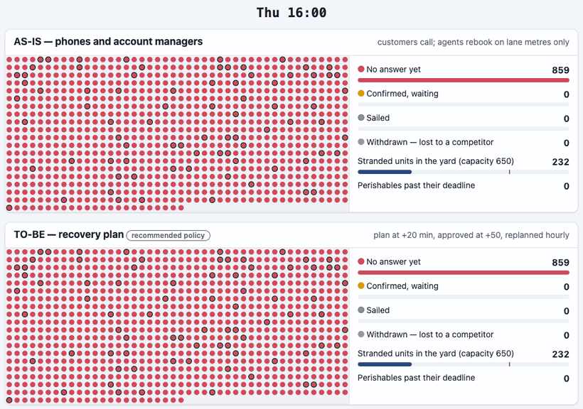

# Storm Night — who sails first when the ships don't?

**An IT business analysis case you can run: from one storm night to a tested, accepted, measurable release.**

> When a storm cancels three sailings and strands 859 trailers, how does a RoRo operator give every customer a new sailing within the hour, in an order three departments can defend — and how do you prove the redesign works before anyone writes production code?

> *Independent portfolio case study based on a fictional organisation (Tidewell Shortsea Lines). It contains no confidential information from any real employer or the hiring company. All figures are illustrative assumptions — not real company data.*

**[▶ Replay the storm night (2-min tour)](https://phlppgdfry.github.io/storm-night-disruption-business-analysis/war-room/?tour)** · **[Live site](https://phlppgdfry.github.io/storm-night-disruption-business-analysis/)** · **[One-page summary (PDF)](site/media/one-page-summary.pdf)** · **[Start here](START-HERE.md)** · **[Evidence](EVIDENCE.md)** · **[All documents](docs/00-documentation-map.md)**

[](https://github.com/phlppgdfry/storm-night-disruption-business-analysis/actions/workflows/ci.yml)

[](https://phlppgdfry.github.io/storm-night-disruption-business-analysis/war-room/?tour)

*Thursday 16:00 to Saturday 09:00, the same storm twice. Top: today, customers call and wait. Bottom: the recovery plan. Red = no answer yet, amber = new sailing confirmed, green = sailed.*

## The night

Thursday 16:00. Storm Kestrel cancels TW-21, TW-23 and TW-25. Today, rebooking waits for customers to call: at 2 a.m. **453 units still have no answer and nobody is working on them**; the yard holds 827 stranded units for 650 slots; contract customers — whom Sales believed were handled first — hear from their account manager **15½ hours** later; 20 perishable reefers sail after their deadline while frozen cargo goes first. Three departments asked for three fixes: more agents, a key-account flag, a phone call to the load planner before every reefer booking.

## What changes (median of 200 simulated nights, AS-IS → TO-BE)

| | AS-IS | TO-BE |
|---|---|---|
| Hours until 90% of stranded units have a confirmed sailing | 17.1 | **0.8** |
| Perishables sailing after their deadline | 21 | **10** (2 with complete booking data) |
| Hours the yard is over capacity | 12.7 | **0** |
| Hours drivers wait at the terminal | 3,361 | **1,841** |
| Units withdrawn to a competitor | 54 | **1** |
| 5-year NPV · chance of a loss when every assumption is uncertain | | **€763k · 6.5%** |
| **Average delay** | ±19 h | **±20 h — unchanged.** A storm removes capacity; no rule creates a ship. |

All numbers are regenerated by CI from [44 stated assumptions](model/assumptions.json); a test fails if a document quotes a number the model does not produce.

## Three things you don't usually see in a BA case

1. **The analysis runs.** A minute-by-minute [simulation](docs/06-simulation/model.md) of the storm night settled a three-way policy conflict, found a flaw in Operations' proposal that nobody saw on paper (ADR units drifting to Sunday → rule R-15), and turned the [business case](docs/06-simulation/business-case.md) into a range with a probability of loss and a tornado of the riskiest assumptions.
2. **The rules are executable.** Sixteen [allocation rules](docs/05-rules/allocation-rules.md), one decision table, [23 Given/When/Then examples](docs/05-rules/features/allocation.feature) run in CI against the module the prototype uses. Every plan line explains itself — the sentence customer service reads out on the phone.
3. **Pull any thread.** From the forwarder who said *"nobody told me my strawberries would sail on Saturday"* to the pain, goal, KPI, rule, story, test and screen. [`check-trace`](scripts/check-trace.mjs) fails the build on a pain nobody voiced, a rule nobody tested, or an ID in a document that does not exist. [Trace explorer](https://phlppgdfry.github.io/storm-night-disruption-business-analysis/trace/).

## The journey

```text
Reconstruct the night   incident timeline from booking, call and gate data — one night everyone argues about
   ↓
Discover                12 stakeholders, 18 voices, contradictions kept, 9 pains
   ↓
Workshop                event storming · policy workshop with the simulation in the room · 11 decisions
   ↓
Model                   BPMN 2.0 AS-IS / TO-BE (valid .bpmn) · UML sequence, state machine, data
   ↓
Rules                   16 rules · decision table · 23 executable examples · 3 conflicts resolved
   ↓
Simulate & decide       200 nights · 4 policies · business case as a range · tornado
   ↓
Backlog                 17 stories, acceptance criteria, WSJF — and where the PO overruled it
   ↓
Design                  recovery board, why-panel, override dialog, messages — clickable on real data
   ↓
Accept                  storm drill as BAT · a severity-1 finding in my own rules → R-16
   ↓
Go live & measure       pre-mortem · shadow mode · go/no-go · rollback · hypercare · benefits review
```

## What I did, as the analyst in this case

- **Reconstructed the last storm before the first interview**, so twelve memories became one timeline — [reconstruction](docs/01-the-night/storm-kestrel-reconstruction.md)
- **Reframed three requested solutions into one problem**: rebooking waits for a phone call — [problem statement](docs/01-the-night/problem-statement.md)
- **Kept the contradictions**: Sales believed key accounts came first; the data said last — [interviews](docs/02-discovery/interviews.md)
- **Facilitated a policy decision with evidence**: each proposal written as rules, simulated on the same nights, measures fixed before results — [policy workshop](docs/03-workshops/policy-workshop.md), [decision log](docs/03-workshops/decision-log.md)
- **Wrote rules precise enough to test**, and the examples that test them — [rules](docs/05-rules/allocation-rules.md)
- **Built the business case as a range**, counted only goodwill paid (weather is force majeure), and named what the redesign cannot fix — [business case](docs/06-simulation/business-case.md)
- **Prepared the backlog with the PO** — [stories](docs/07-backlog/epics-and-stories.md), [prioritisation](docs/07-backlog/prioritisation.md)
- **Designed and validated the screens** in four rounds — [design](docs/08-design/recovery-board.md), [prototype](https://phlppgdfry.github.io/storm-night-disruption-business-analysis/war-room/?tab=board)
- **Ran business acceptance as a storm drill** and owned the defect it found in my own rules — [storm drill](docs/09-acceptance/storm-drill.md)
- **Prepared go-live** with a pre-mortem, shadow mode and a benefits review that replaces assumptions with measurements — [pre-mortem](docs/10-go-live/premortem.md), [readiness](docs/10-go-live/readiness.md), [benefits review](docs/11-measure/benefits-review.md)

## Repository map

| Path | What |
|---|---|
| [`docs/`](docs/00-documentation-map.md) | The analysis, numbered along the journey |
| [`model/`](model/) | `trace.json` (traceability), `assumptions.json` (44 assumptions with ranges), `storm-night.json` (sailings and capacity) |
| [`site/assets/lib/`](site/assets/lib/) | `allocate.mjs` (the rules), `simulate.mjs` (the storm night), `scenario.mjs`, `business-case.mjs` — plain JavaScript, no dependencies, the same code in CI and in the browser |
| [`tests/`](tests/) | 23 allocation examples, simulation invariants, traceability, documents-quote-the-model |
| [`scripts/`](scripts/) | `build-results.mjs` (200 nights → results), `check-trace.mjs`, `build_bpmn.py`, `build_workbook.py`, `build_media.py` (GIF, social card, one-page PDF), `check-links.py` |
| [`data/`](data/) | Excel workbook: assumptions, simulation medians, business case with live formulas, policies, tornado |
| `site/` | GitHub Pages: landing, war room (replay · recovery board · policy lab), business case, trace explorer, process; `site/media/` holds the GIF, social card and one-page summary |

```bash
node --test tests/*.test.mjs        # 43 tests: examples, invariants, trace, document claims
node scripts/build-results.mjs      # re-run 200 + 200 nights and the tornado (±1 min)
node scripts/check-trace.mjs        # traceability chain
python3 -m http.server -d site      # the site, locally
```

Companion cases on the same fictional operator: [late booking amendments](https://github.com/phlppgdfry/shortsea-booking-functional-analysis) (functional analysis) · [shipment exceptions](https://github.com/phlppgdfry/shipment-exception-management-business-analysis) (business analysis).

## Honest limits

- **Fictional** organisation, people, interviews, workshops, drill and decisions. The shape of the problem is realistic; the facts are not anyone's.
- **The simulation is a model**, not a forecast: it ignores stowage detail, rerouting, goodwill beyond the night and agent mistakes (which makes the AS-IS look *better* than it is). Its assumptions are listed, ranged and stress-tested; the [benefits review](docs/11-measure/benefits-review.md) replaces them with measurements.
- **The allocation module** exists to prove the rules are precise enough to build and test — not to suggest that the analyst writes production code.
- **Not interviewed:** the master and crew (out of scope), and customers who already left for a competitor.
- **Not claimed:** experience running this change at a real operator. Built by one person, with AI assistance; every decision and its reasoning is in the [decision log](docs/03-workshops/decision-log.md).
