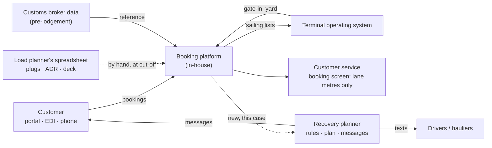

# Context — Tidewell Shortsea Lines on a storm night

> **What this is:** the fictional organisation, its route, its systems and the scope of this case. **For:** anyone opening the case for the first time. **Previous:** [reconstruction of Storm Kestrel](../01-the-night/storm-kestrel-reconstruction.md) · **Next:** [stakeholders](stakeholders.md).

*Independent portfolio case study based on a fictional organisation. It contains no confidential information from any real employer or the hiring company. All figures are illustrative assumptions — not real company data.*

## The organisation

**Tidewell Shortsea Lines** is a fictional RoRo freight operator between a Belgian continental terminal and two UK terminals (Humber and Thames) and one Irish terminal. This is the third case set at Tidewell:

| Case | Lens | Question |
|---|---|---|
| [Late booking amendments](https://github.com/phlppgdfry/shortsea-booking-functional-analysis) | Functional analyst | How do four amendment channels become one set of testable rules? |
| [Shipment exceptions](https://github.com/phlppgdfry/shipment-exception-management-business-analysis) | Business analyst | How do we tell customers about a delay before they call? |
| **Storm Night (this case)** | Business analyst + simulation | When sailings are cancelled, who sails first — and how do we prove the answer before we build it? |

## The route in this case

**Continent terminal → Humber terminal**, overnight freight sailings every four hours, plus a relief vessel the operations director can call in. Freight is mostly unaccompanied trailers (the driver drops the trailer and leaves), with accompanied trucks (the driver sails along), reefers (refrigerated trailers that need a power plug on board), dangerous goods under ADR (only in specific weather-deck slots) and some oversized project cargo (only on vessels with a high deck).

## Systems

| System | Owner | Relevant here |
|---|---|---|
| **Booking platform** (in-house) | Product Owner Booking Platform (S-07) | Holds bookings, sailings and free lane metres. **Does not hold** reefer plugs, ADR slots or deck height per sailing. Commodity is free text; there is no deliver-by time. |
| Terminal operating system | Terminal IT | Gate-in time per unit — the only reliable "is it here?" |
| Load planner's spreadsheet | Load planning (S-05) | Plugs, ADR slots and deck per vessel. Checked at cut-off, 90 minutes before departure. |
| Customer service booking screen | Customer service (S-03) | Rebooks one unit at a time; shows lane metres only. |
| Customs broker data | Customs desk (S-08) | Whether a UK import pre-lodgement exists for the unit. |

## Scope

**In:** what happens between the decision to cancel sailings and the moment the last stranded unit sails — finding the stranded units, deciding who goes on which recovery sailing, telling customers and drivers, and handling changes overnight.

**Out:** the decision to cancel (that is the master's and the operations director's call on weather), the stowage plan itself, claims handling, and the inbound direction (the same approach applies; it is not modelled).

## Glossary

| Term | Meaning here |
|---|---|
| **Stranded unit** | A freight unit (trailer, truck, container on a trailer) booked on a cancelled sailing |
| **Recovery sailing** | A later sailing with free capacity, or the relief vessel |
| **Lane metres (lm)** | Deck length a unit takes: trailer ±14 m, accompanied truck ±17.5 m, project cargo ±22 m |
| **Reefer / plug** | Refrigerated trailer; needs one of the limited power plugs on board |
| **ADR slot** | A deck position where dangerous goods may be carried |
| **Cut-off** | 90 minutes before departure: load planning closes, later changes miss the sailing |
| **Pre-lodgement** | The UK import declaration that must exist before the unit may be loaded |
| **Time to certainty** | Hours from the cancellation decision until a unit has a confirmed new sailing — the headline measure ([D-01](../03-workshops/decision-log.md)) |
| **Hold at origin** | Asking the haulier not to bring the unit until a few hours before its new sailing |
| **Allotment** | Capacity a contract customer has bought for the year |
| **Duty manager** | The operations manager on shift; owns the recovery on the night (S-04) |
