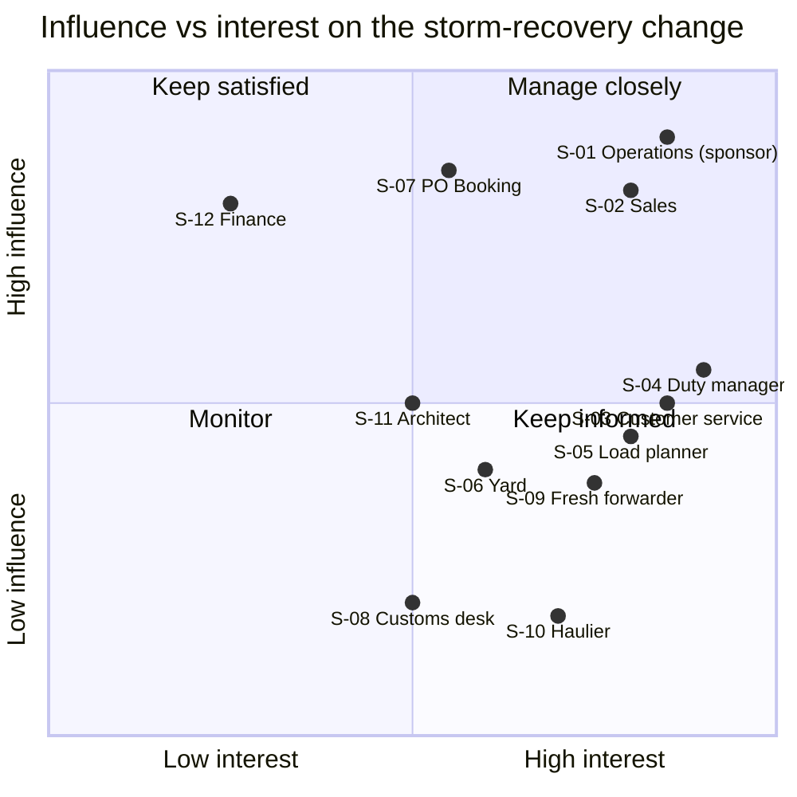

# Stakeholders

> **What this is:** who has a stake in a storm night, what they want, and where they collide. **For:** the BA, sponsor and PO when planning workshops. **Previous:** [context](context.md) · **Next:** [interviews](interviews.md).

*Fictional people.*

## Map

| ID | Who | Wants | Fears | How I worked with them |
|---|---|---|---|---|
| S-01 | Marit Claes, Director Operations — **sponsor** | Recovery that is "boring": the same every time | Another night where the rules depend on who is on duty | Monthly steering; owns the policy decision (D-04) |
| S-02 | Jonas Verbeke, Head of Sales & Key Accounts | Contract customers first | Losing a key account over one storm | Interview; showed him the reconstruction (his customers were handled *last*); policy workshop |
| S-03 | Aylin Demir, Customer Service Team Lead | Fewer calls; a rule her agents can defend | Agents blamed for decisions they did not make | Interview; shadowed the evening desk on a normal cancellation; BAT key user |
| S-04 | Rui Santos, Duty Manager (nights) — **primary user** | The backlog at a glance; to understand every allocation before signing | Signing off a black box | Two interviews, design reviews of every screen, storm drill lead |
| S-05 | Hanna Peeters, Load Planner | No more bumping at cut-off | Losing control over stowage | Interview at her desk during a cut-off; owns the constraint data (D-03) |
| S-06 | Kofi Mensah, Yard Manager | Hauliers kept away until there is a ship | Access road blocked, safety incident | Site walk; reviewed the hold-at-origin text |
| S-07 | Elke Wouters, PO Booking Platform | Testable rules; a slice before winter | A "fairness engine" nobody can test | Weekly refinement; owns the backlog and the release split |
| S-08 | Lies Van Damme, Customs Desk Lead | Units without pre-lodgement kept off recovery sailings | Being blamed for refused units | Short interview; reviewed R-06 |
| S-09 | Sofie Lambrecht, fresh-produce forwarder (customer) | To know early when her perishables sail | Explaining spoiled goods to a supermarket | Customer interview by video; tested the message text |
| S-10 | Tomasz Nowak, haulage company owner (customer) | His drivers told directly | Drivers losing a day in the cab | Customer interview at the gate |
| S-11 | Daan Hermans, Solution Architect | Sailing constraints in one place | Another spreadsheet integration | Technical sessions on data and messaging (D-03, D-09) |
| S-12 | Nadia El Amrani, Finance Controller | A case that does not count rejected claims | A business case built on force majeure | Reviewed the business case method (D-07) |

## Where they collide

| Conflict | Between | About | Resolved by |
|---|---|---|---|
| **C-1 Who sails first** | Sales (S-02) vs customer service (S-03) vs operations (S-05) | Key accounts first, or first booked first served, or perishables and drivers first | Policy workshop with the simulation in the room → D-04. See [conflicts](../05-rules/conflicts.md) |
| **C-2 Who owns the constraint data** | Load planner (S-05) vs PO Booking Platform (S-07) | Plugs/ADR/deck in a spreadsheet vs in the platform | D-03: sailing attributes in the platform, maintained by load planning |
| **C-3 Who presses send** | Customer service (S-03) vs operations (S-01) | Customer service wanted to approve each message; operations wanted it automatic | D-02: the duty manager approves the plan once; messages follow the plan; customer service sees every message |

## What I did not do

I did not interview the master or the vessel crew: the decision to cancel is out of scope. I did not speak to the competing operator's customers who left. Both are noted as gaps in [honest limits](../../README.md#honest-limits).
