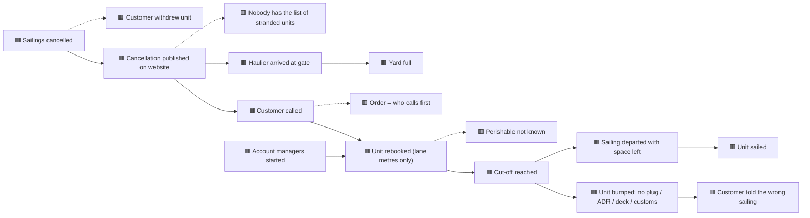

# Event storming — the storm night, big picture

> **What this is:** the plan, the board and the hotspots of a big-picture event storming on the storm night. **For:** the team and stakeholders who were (or were not) in the room. **Previous:** [interviews](../02-discovery/interviews.md) · **Next:** [policy workshop](policy-workshop.md).

*Fictional workshop. The board is also on the [site](https://phlppgdfry.github.io/storm-night-disruption-business-analysis/process/#event-storming).*

## Set-up

| | |
|---|---|
| Who | Duty manager (S-04), customer service lead (S-03) + one agent, load planner (S-05), yard manager (S-06), customs desk (S-08), architect (S-11), PO (S-07). Sales (S-02) for the last hour. |
| Time | 3 hours, one long wall (or one FigJam board) |
| Legend | 🟧 domain event (past tense) · 🟦 command · 🟨 actor · 🟪 policy ("whenever … then …") · 🟥 hotspot (problem, question, conflict) · 🟩 read model (what someone looks at to decide) |
| Flow | 1. Chaotic exploration: everyone writes events, 15 min, no discussion · 2. Enforce the timeline · 3. Mark hotspots · 4. Walk it backwards from "unit sailed" · 5. Add commands, actors, read models · 6. Vote on the three hotspots that hurt most |
| My role | Facilitator: keep it in the past tense, keep solutions out until step 5, make sure the night desk speaks before the managers do |

## The timeline (AS-IS, after step 4)

## Hotspots, and who decided

| # | Hotspot | Votes | Outcome | Decided by |
|---|---|---|---|---|
| 1 | **Nobody has the list** of stranded units with what each needs | 7 | Becomes the first read model: the recovery board (US-01) | Duty manager (S-04) |
| 2 | **The order is "who calls first"** — and nobody agrees what it should be | 6 | Cannot be solved in this room → separate [policy workshop](policy-workshop.md) with the simulation (D-04) | Sponsor (S-01) |
| 3 | **Constraints found at cut-off** (plugs, ADR, deck, customs) | 6 | Constraints become sailing attributes (D-03); customs status read before planning (R-06) | PO (S-07), load planner (S-05) |
| 4 | Perishable reefers are invisible | 4 | Mandatory commodity and deliver-by for reefers (US-02, D-05) | PO (S-07); Sales consulted (commercial impact) |
| 5 | Hauliers come anyway | 4 | Hold-at-origin text to the driver/haulier (US-12) | Yard (S-06) |
| 6 | "Who presses send?" | 3 | D-02: one approval of the plan by the duty manager | Sponsor (S-01) |
| 7 | Rerouting via Thames | 2 | Parked for release 2 (D-10) | PO (S-07) |

## TO-BE events (step 5, first draft)

🟧 Sailings cancelled → 🟪 *whenever sailings are cancelled, list the stranded units* → 🟧 Stranded units listed → 🟦 Build recovery plan → 🟧 Recovery plan proposed → 🟩 Recovery board → 🟨 Duty manager → 🟦 Approve plan → 🟧 Plan approved → 🟪 *whenever a plan is approved, message customers and text drivers* → 🟧 Customer informed · 🟧 Driver told to hold → 🟪 *every hour, plan what is still open without moving confirmed units* → 🟧 Unit confirmed → 🟧 Unit sailed

The commands, policies and read models from this draft became the [TO-BE process](../04-process/to-be.md) and the epics *Detect & size, Plan, Decide, Tell, Learn* in the [backlog](../07-backlog/epics-and-stories.md).

## What I would do differently

I invited Sales for the last hour only, to keep the first part operational. That meant Sales saw hotspot 2 as a finished framing ("the order is wrong") rather than something they helped find. In the policy workshop I started with their own data — the reconstruction showing key accounts were handled last — and that recovered it.
