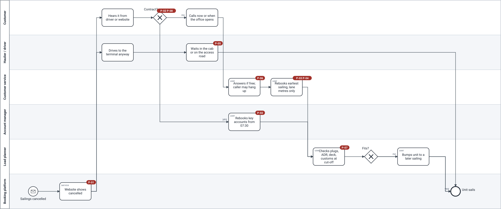

# AS-IS — a storm night today

> **What this is:** the current process in BPMN 2.0, with each pain marked where it happens. **For:** sponsor, team, stakeholders. **Previous:** [decision log](../03-workshops/decision-log.md) · **Next:** [TO-BE](to-be.md).

*Fictional operator. Source: the [reconstruction](../01-the-night/storm-kestrel-reconstruction.md), the interviews and one evening shadowing the customer service desk.*

Model file: [`bpmn/as-is.bpmn`](bpmn/as-is.bpmn) (BPMN 2.0 with diagram interchange — opens in Camunda Modeler or bpmn.io). Generated from [`scripts/build_bpmn.py`](../../scripts/build_bpmn.py) so a change is reviewable as a diff.

## Reading it

| Step | What happens | Pain |
|---|---|---|
| Sailings cancelled → website | The cancellation is published per sailing, not per unit. No list of stranded units exists. | P-01 |
| Customer hears about it | From the driver, the terminal or the website — not from Tidewell. | P-01 |
| Contract customer? | Contract customers wait for their account manager (from 07:30); others call. The *gateway itself* is the problem: it decides the rebooking order by customer type and call timing, not by need. | P-02, P-08 |
| Customer service answers | Four agents in the evening, two at night. Callers who wait too long hang up and call again. | P-06 |
| Rebooks earliest sailing | One unit at a time, on the first sailing with lane metres free. The screen shows no plugs, ADR slots, deck height or customs status, and nothing about perishables. | P-03, P-04 |
| Hauliers drive in anyway | Nobody tells them not to. The yard passes capacity before midnight. | P-05 |
| Cut-off check | 90 minutes before departure the load planner checks plugs, ADR, deck and customs — the first time anyone does. | P-07 |
| Bump | Units that do not fit are moved to a later sailing. The freed space cannot be refilled: stowage is closed. | P-03 |

## What the model leaves out on purpose

The master's decision to cancel, the stowage plan, claims and the inbound direction — out of scope, see [context](../02-discovery/context.md#scope).
