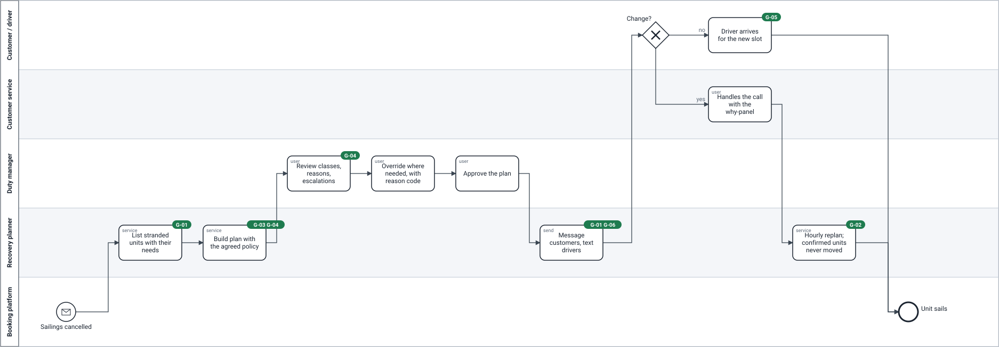

# TO-BE — the recovery plan (release 1)

> **What this is:** the redesigned process in BPMN 2.0, each step marked with the goal it serves. **For:** sponsor, PO, team. **Previous:** [AS-IS](as-is.md) · **Next:** [UML](uml.md).

*Fictional operator.*

Model file: [`bpmn/to-be.bpmn`](bpmn/to-be.bpmn).

## Reading it

| Step | Who | What changes | Goal |
|---|---|---|---|
| List stranded units with their needs | Recovery planner (system) | Within minutes of the cancellation: every unit with type, lane metres, perishable flag and deadline (US-02), arrival status, customs status and customer. | G-01 |
| Build plan with the agreed policy | Recovery planner | All units at once, by the [allocation rules](../05-rules/allocation-rules.md). Each line carries its reasons. | G-03, G-04 |
| Review classes, reasons, escalations | Duty manager | The [recovery board](../08-design/recovery-board.md): capacity per sailing, units per class, perishables that will miss their deadline (R-14). | G-04 |
| Override where needed | Duty manager | With a reason code (R-12). Hard constraints still apply. Every override is logged and counted (K-06). | G-04 |
| Approve the plan | Duty manager | One approval for the whole plan (D-02). Target: within 30 minutes. | G-01 |
| Message customers, text drivers | Recovery planner | One message per customer with every unit and its new sailing; a text to the driver or haulier contact: *hold at origin, arrive by …* (US-11, US-12). | G-01, G-06, G-05 |
| Change? | Customer | Most customers do nothing. A few call or reply. | — |
| Handles the call with the why-panel | Customer service | The agent sees the plan line and its reasons (US-13) and can explain, not argue. | G-04 |
| Hourly replan | Recovery planner | Customs releases, no-shows and changes are planned on remaining capacity; confirmed units are never moved to a later sailing (R-11). | G-02 |

## What the TO-BE deliberately does *not* do

- **It does not decide alone.** The plan is a proposal until the duty manager approves it (D-02).
- **It does not move confirmed units** to make room for later arrivals, even perishables. Certainty once given is kept (R-11); a perishable that cannot make it is escalated instead (R-14).
- **It does not reroute or pull units forward** in release 1 (D-10).
- **It does not create capacity.** See [what the redesign cannot fix](../06-simulation/business-case.md#what-the-redesign-cannot-fix).

## How the TO-BE was tested before anything was built

The same process runs inside the [simulation](../06-simulation/model.md): plan at +20 min, approval at +50 min, replan every hour, messages acted on by a share of hauliers (A-34). The TO-BE in this diagram is what produced the TO-BE column in the [results](../06-simulation/results.md).
