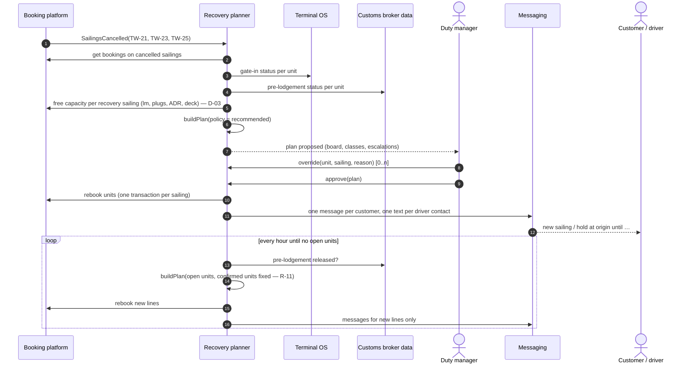
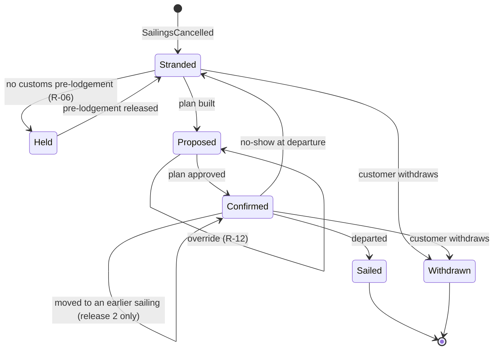
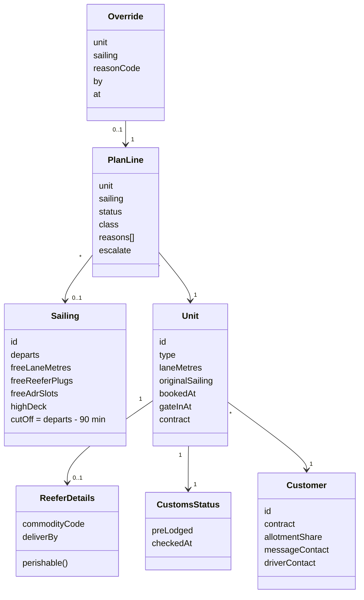

# UML — sequence, life cycle of a stranded unit, data

> **What this is:** the TO-BE in UML for the development team: who talks to whom, which states a unit goes through, and the data the rules need. **For:** developers, tester, architect (S-11). **Previous:** [TO-BE](to-be.md) · **Next:** [allocation rules](../05-rules/allocation-rules.md).

*Fictional systems. Drawn in Mermaid so the diagrams live next to the text and change in the same pull request.*

## Sequence — from cancellation to messages

**Error paths the team asked about in refinement:**

| What fails | Behaviour |
|---|---|
| Booking platform rejects a rebooking (capacity changed meanwhile) | The line returns to *open* and is planned in the next round; the duty manager sees a counter of failed lines |
| Messaging provider down | Plan stays approved; messages queue and retry; customer service sees "not yet sent" per customer |
| Customs data unavailable | Units are treated as *not pre-lodged* (held) — the safe side; the board shows "customs data stale since …" |
| Duty manager does not approve within 60 minutes | Escalation to the operations director on call; nothing is sent unapproved (D-02) |

## State machine — a stranded unit

*Confirmed → later sailing* does not exist: that is R-11.

## Data the rules need

**New data in release 1:** `Sailing.freeReeferPlugs / freeAdrSlots / highDeck` (D-03), `ReeferDetails.commodityCode / deliverBy` (D-05), `Customer.driverContact` (D-09), `Override` (US-09).
