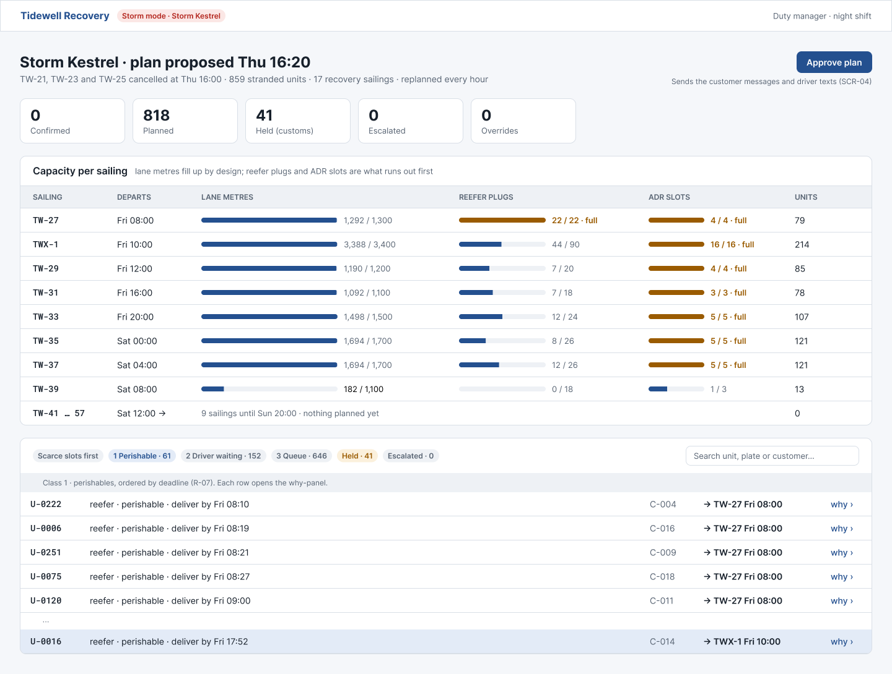
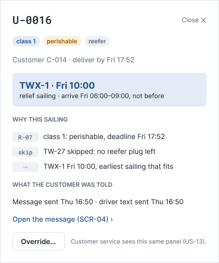
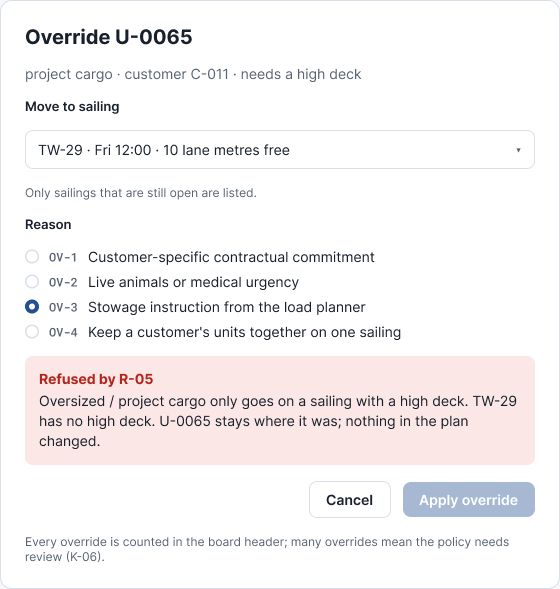
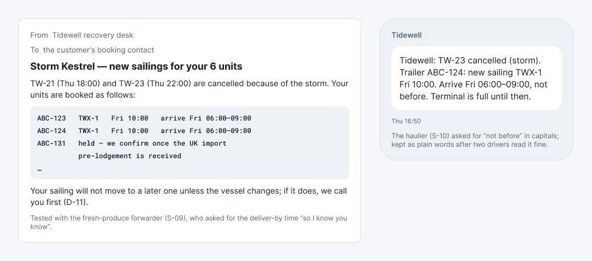
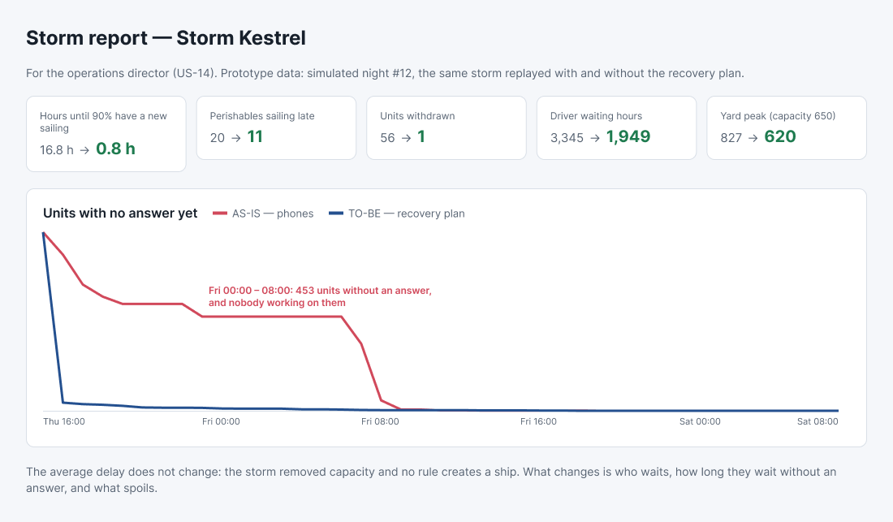
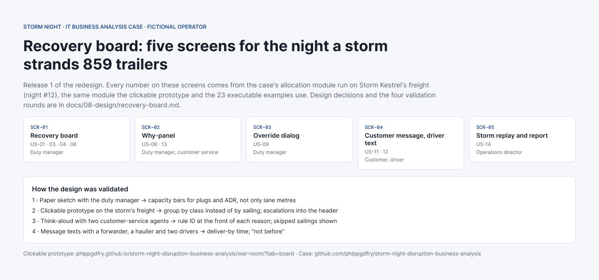

# Design — the recovery board

> **What this is:** the screens of release 1, the design decisions behind them and how they were checked with users. **For:** duty manager (S-04), customer service (S-03), developers. **Previous:** [prioritisation](../07-backlog/prioritisation.md) · **Next:** [storm drill (BAT)](../09-acceptance/storm-drill.md).

*Fictional. The five screens exist twice: as a [Figma file](https://www.figma.com/design/yIkhJZeEEmHT9Eaxd2Amzc) (colour tokens, components for button, chip, count and unit row; previews below) and as a clickable prototype on the [war room](https://phlppgdfry.github.io/storm-night-disruption-business-analysis/war-room/?tab=board) page, running on the real allocation module with Storm Kestrel's freight — not a mock-up with invented rows.*

## Screens

| | |
|---|---|
|  |  |
|  |  |
|  |  |

The Figma screens use the plan the allocation module builds at Thu 16:20 on night #12: the sailings, capacities, counts and the reasons for U-0016 are the module's output, not invented rows.


| ID | Screen | Stories | Main user |
|---|---|---|---|
| SCR-01 | Recovery board | US-01, US-03, US-04, US-08 | Duty manager |
| SCR-02 | Why-panel per unit | US-06, US-13 | Duty manager, customer service |
| SCR-03 | Override dialog | US-09 | Duty manager |
| SCR-04 | Customer message and driver text | US-11, US-12 | Customer, driver (preview for the duty manager) |
| SCR-05 | Storm replay and storm report | US-14 | Operations director |

## Recovery board (SCR-01)

```text
┌ Storm Kestrel · plan proposed Thu 16:20 · 859 units ─────────── [ Approve plan ] ┐
│ Confirmed 0 · Planned 818 · Held (customs) 41 · Escalated 0 · Overrides 0        │
├──────────────────────────────────────────────────────────────────────────────────┤
│ Sailing   Departs     Lane metres        Plugs      ADR     Units               │
│ TW-27     Fri 08:00   ████████████ 1292  ███ 22/22  ██ 4/4   79                  │
│ TWX-1     Fri 10:00   ████████████ 3388  █░░ 43/90  ██ 16/16 214                 │
│ TW-29     Fri 12:00   ████████████ 1190  ...                                    │
├──────────────────────────────────────────────────────────────────────────────────┤
│ [Scarce] [1 Perishable] [2 Driver] [3 Queue] [Held] [Escalated]   search unit…  │
│ U-0016  reefer · perishable · Fri 17:52   → TWX-1   why ›                       │
└──────────────────────────────────────────────────────────────────────────────────┘
```

**Design decisions**

| Decision | Why | Checked with |
|---|---|---|
| Capacity bars per sailing for lane metres, plugs **and** ADR, side by side | The duty manager's first question is "is anything about to break?" — plugs and ADR run out before lane metres do | Duty manager, design review 1 |
| Units grouped by **class**, not by customer | The order is the policy; showing it by class makes the policy visible and reviewable in minutes (BAT-04) | Duty manager; Sales asked for a customer view → added as a filter, not the default |
| **Escalated** and **Held** as their own tabs with counts in the header | These are the units that need a person tonight; everything else just needs approval | Customer service lead |
| One **Approve plan** button, disabled while overrides are being edited | D-02: one approval, no half-approved plans | Sponsor |
| No colour as the only signal: every state also has a word | Night shift, tired eyes, colour-blind colleagues | Accessibility checklist |

## Why-panel (SCR-02)

Opens beside the board for one unit; the same panel is what customer service sees (US-13).

```text
U-0016 · reefer · perishable, deliver by Fri 17:52 · customer C-014
  R-07 class 1: perishable, deadline Fri 17:52
  TW-27 skipped: no reefer plug left
  → TWX-1 Fri 10:00, earliest sailing that fits
  Message sent Thu 16:50 · driver text sent Thu 16:50
  [ Override… ]
```

**Design decisions:** reasons in plain words with the rule ID at the start (agents read the words, support and developers use the ID); skipped sailings shown, because "why not the earlier one?" is the first question every customer asks; the message actually sent is shown, so the agent says exactly what the customer read.

## Override dialog (SCR-03)

Choose a sailing (only sailings that are still open are listed) and a reason code (OV-1 … OV-4). If a hard rule refuses it, the dialog says which rule and why, and the unit stays where it was (SC-16). The board's header counts overrides; a high count is a signal that the policy needs review (K-06).

## Customer message and driver text (SCR-04)

```text
Subject: Storm Kestrel — new sailings for your 6 units

TW-21 (Thu 18:00) and TW-23 (Thu 22:00) are cancelled because of the storm.
Your units are booked as follows:
  ABC-123  TWX-1  Fri 10:00   arrive Fri 06:00–09:00
  ABC-124  TWX-1  Fri 10:00   arrive Fri 06:00–09:00
  ABC-131  held — we confirm once the UK import pre-lodgement is received
  …
Your sailing will not move to a later one unless the vessel changes; if it does, we call you first (D-11).
```

```text
Tidewell: TW-23 cancelled (storm). Trailer ABC-124: new sailing TWX-1 Fri 10:00.
Arrive Fri 06:00–09:00, not before. Terminal is full until then.
```

Tested with the fresh-produce forwarder (S-09) and the haulier (S-10): the forwarder asked for the deliver-by time in the message ("so I know you know"); the haulier asked for "not before" in capitals — kept as plain words after a test with two drivers who read it fine.

## How the design was validated

| Round | With | What changed |
|---|---|---|
| 1. Paper sketch | Duty manager | Capacity bars added for plugs and ADR, not only lane metres |
| 2. Clickable prototype on Storm Kestrel's freight | Duty manager, load planner | Group by class instead of by sailing; escalations moved into the header |
| 3. Prototype, think-aloud | Two customer-service agents | Why-panel: rule ID moved to the front, skipped sailings added |
| 4. Message texts | Forwarder, haulier, two drivers | Deliver-by time in the message; "not before" |

## What is not designed yet

Mobile view for the duty manager on call (release 2), the storm report as a printable one-pager, and the Thames reroute offer (US-16).
